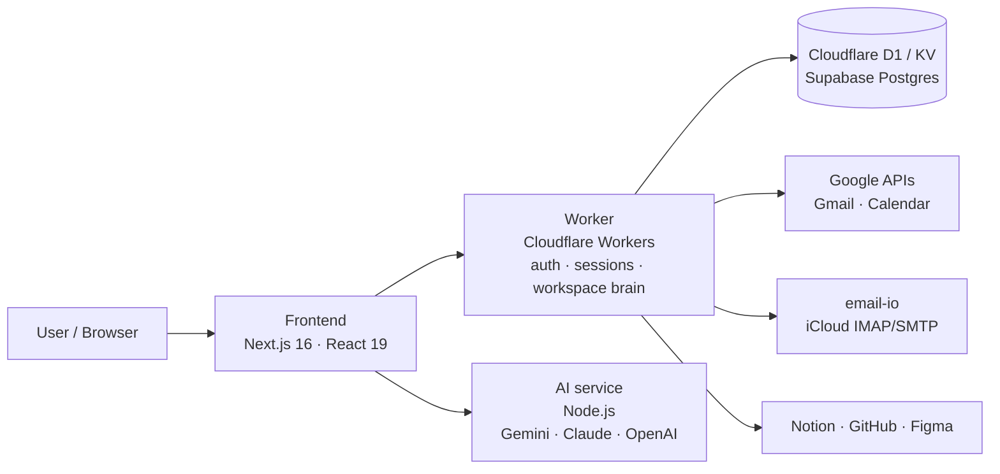

# Elyra Core

    

**An AI operating system for running a small business – built solo by [Paul Odak](https://github.com/MrAtEase).**

Elyra Core is a browser-based "AI OS": a desktop-style workspace where an AI assistant works across your mail, calendar, tasks and code – and asks for approval before it does anything that matters.

I designed it alongside my franchise start-up **Fish Delish Portugal** (2022–2026) and built it in about eight months, as the operating system for the business (master franchise of a Croatian fish fast-food chain). The idea: one founder, a handful of stores, and an AI that handles the daily admin – briefings, emails, scheduling, documents – so the team can focus on the business. The franchise was stopped in 2026; Elyra Core remains as a working prototype.

> **Status:** prototype / portfolio project – not deployed. Production services and accounts have been shut down.


<table><tr>
<td width="50%"></td>
<td width="50%"></td>
</tr><tr>
<td align="center"><sub>App launcher – one list, clear categories</sub></td>
<td align="center"><sub>Own app built from a template (sample data), running in a sandbox</sub></td>
</tr></table>

---

## What it does

| Area | What Elyra can do |
|---|---|
| **Workspace OS** | Desktop-style shell with windows (open, focus, drag, resize), dock, workspace switcher, light/dark themes and a global "intent line" for natural-language commands |
| **AI assistant ("Elly")** | Morning briefings, drafting replies, scheduling suggestions, creating tasks from natural language |
| **Mail** | Gmail API and iCloud (IMAP/SMTP) – thread list, read, AI-drafted replies, supervised sending |
| **Calendar** | Google Calendar and CalDAV (iCloud) – list, create, update and delete events |
| **Tasks & docs** | Task management, Notion integration, docs and slides windows |
| **Marketplace & own apps** | Optional apps, skills and templates per workspace; Elly builds small apps on request – once approved they appear under Apps and run in a sandboxed iframe with their own data |
| **Team & roles** | Company workspaces with owner, admin, member and guest roles; invitations bound to one email address, single-use and valid for 7 days; every change in the audit log |
| **Governance** | User approval for destructive actions, workspace-level policies, audit log |

## Marketing tools

Built as prototypes with sample data – each one follows the same rule: Elly analyses and proposes, a person approves, and only then is anything exported or changed.

| Tool | What it does |
|---|---|
| **Ads audit** | Finds expensive Google Ads search terms without conversions and proposes negative keywords; approved items export as a Google Ads Editor CSV |
| **Paid × Organic** | Compares Google Ads with Search Console: where you pay for clicks you already win organically |
| **Feed optimiser** | Checks Google Shopping feeds and rewrites titles and descriptions with AI, with approval and export |
| **AI visibility** | Measures whether ChatGPT, Gemini and Claude recommend a brand, including a competitor comparison |
| **Reporting** | Marketing KPIs and campaign reports in one place |
| **Newsletter digest** | Summarises industry sites and newsletters into a briefing with sources |
| **Leads** | Finds new prospects and prepares outreach |
| **Agent team** | Several AI agents working together on copy, design, presentations and campaigns |
| **Automations** | Connects Elyra to n8n, Make or Zapier via webhooks and API tokens |

## Highlights for reviewers

- **Multi-provider AI routing** – tasks are routed to Gemini, Claude or OpenAI depending on the job (large-context review, multi-step reasoning, code generation), with automatic fallback when a provider is unavailable.
- **Human-in-the-loop by design** – the assistant proposes, the user approves. Destructive actions require explicit confirmation and are written to an audit table.
- **Connectors & auth** – OAuth 2.0 for Google, Microsoft and Apple; secure session cookies across subdomains; HMAC-signed internal APIs.
- **Workspace isolation** – one login, several separate workspaces (personal, company). Every API route checks membership on the server; the AI service verifies it again with the worker. See [`SECURITY.md`](SECURITY.md).
- **MCP support** – workspaces can configure Model Context Protocol (MCP) servers that Elly can use as tools.
- **Teams without data leaks** – company workspaces get members and roles; personal workspaces stay private by design, even for admins of a company workspace.
- **Quality** – unit and end-to-end tests (Playwright), including security, auth-flow and workspace-policy checks, plus an evaluation harness for AI responses.

## Security model

- **One login, separate workspaces.** A user can switch between their personal and company workspaces; data never mixes. Every API route checks workspace membership on the server, and the AI service verifies it again with the worker before touching any data.
- **No shortcuts.** There is no development-mode bypass around authentication or membership checks; the platform owner is configured by exact email address, never by domain.
- **Teams by invitation only.** Only owners and admins invite; a link works once, for one email address, for 7 days. Only its hash is stored.
- **Sandboxed mini-apps.** Tools built by Elly run in an isolated iframe without network or same-origin access.

Details: [`SECURITY.md`](SECURITY.md).

## Architecture



| Folder | Purpose |
|---|---|
| `frontend/` | Next.js app – OS shell, windows, API routes |
| `worker/` | Cloudflare Worker – OAuth, sessions, mail & calendar, orchestration |
| `backend/ai-service/` | AI provider calls (Gemini, Claude, OpenAI) |
| `email-io/` | Internal service for iCloud mail (IMAP/SMTP) |
| `docs/` | Development guide and rules |

**Tech stack:** TypeScript, Next.js 16, React 19, Tailwind CSS, Cloudflare Workers (D1, KV), Supabase, Node.js, Playwright, Zod.

## Run the UI locally (preview mode)

The full system needs OAuth clients and API keys. To explore the interface without them, run the frontend in local preview mode with example data (development only, never in production):

```bash
npm install --workspace=frontend
cp frontend/.env.example frontend/.env.local
ELYRA_LOCAL_PREVIEW=1 npm run dev --workspace=frontend -- -p 3100
```

Then open **http://localhost:3100/os**. Try typing *"briefing"* or *"my day"* into the intent line for a demo flow.

For the full local setup (worker, AI service, secrets), see [`docs/DEVELOPMENT.md`](docs/DEVELOPMENT.md) and the `.env.example` files.

## How it was built

I built Elyra Core on my own, acting as product owner and developer. I used AI coding assistants (Gemini, Claude, OpenAI) as pair programmers – the same multi-provider approach the product itself uses. The rules for people and assistants are in [`docs/DEVELOPMENT.md`](docs/DEVELOPMENT.md).

**What I learned:** designing safe agent workflows (approval before action), building and maintaining many third-party connectors, and keeping a large AI-assisted codebase consistent with clear contracts and tests.

**What I would do next:** a proper MCP server that exposes Elyra's mail, calendar and tasks to external AI tools, usage analytics for the assistant, and a cleaner separation between the demo data and the live connectors.

## License

© 2026 Paul Odak. All rights reserved. The code is public so it can be reviewed and evaluated; please ask before reusing it. Security issues: see [`SECURITY.md`](SECURITY.md).

---

**Paul Odak** · Product & AI · Lisbon area · [GitHub](https://github.com/MrAtEase)
