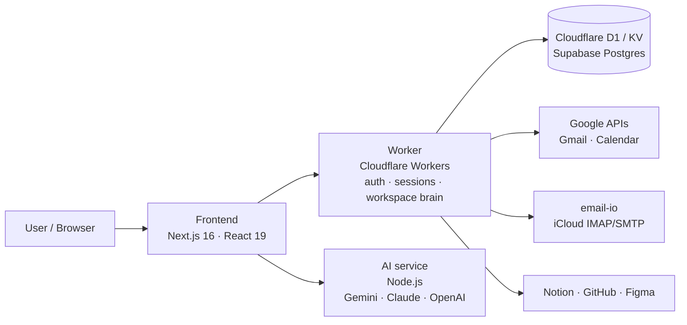

# Elyra Core

**An AI operating system for running a small business – built solo by [Paul Odak](mailto:paul.odak@icloud.com).**

Elyra Core is a browser-based "AI OS": a desktop-style workspace where an AI assistant works across your mail, calendar, tasks and code – and asks for approval before it does anything that matters.

I designed and built it between 2022 and 2026 as the operating system for my franchise start-up, **Fish Delish Portugal** (master franchise of a Croatian fish fast-food chain). The idea: one founder, a handful of stores, and an AI that handles the daily admin – briefings, emails, scheduling, documents – so the team can focus on the business. The franchise was stopped in 2026; Elyra Core remains as a working prototype.

> **Status:** prototype / portfolio project – not deployed. Production services and accounts have been shut down.

---

## What it does

| Area | What Elyra can do |
|---|---|
| **Workspace OS** | Desktop-style shell with windows (open, focus, drag, resize), dock, workspace switcher, light/dark themes and a global "intent line" for natural-language commands |
| **AI assistant ("Elly")** | Morning briefings, drafting replies, scheduling suggestions, creating tasks from natural language |
| **Mail** | Gmail API and iCloud (IMAP/SMTP) – thread list, read, AI-drafted replies, supervised sending |
| **Calendar** | Google Calendar and CalDAV (iCloud) – list, create, update and delete events |
| **Tasks & docs** | Task management, Notion integration, docs and slides windows |
| **Coding agent** | An in-app AI coding assistant that plans, writes and applies code changes with a build gate and rollback |
| **Governance** | User approval for destructive actions, workspace-level policies, audit log, invite-only access |

## Highlights for reviewers

- **Multi-provider AI routing** – tasks are routed to Gemini, Claude or OpenAI depending on the job (large-context review, multi-step reasoning, code generation), with automatic fallback when a provider is unavailable.
- **Human-in-the-loop by design** – the assistant proposes, the user approves. Destructive actions require explicit confirmation and are written to an audit table.
- **Connectors & auth** – OAuth 2.0 for Google, Microsoft and Apple; secure session cookies across subdomains; HMAC-signed internal APIs; workspace-scoped data isolation.
- **MCP support** – workspaces can configure Model Context Protocol (MCP) servers that the coding agent uses as tools.
- **Robust patch pipeline** – AI-generated diffs are repaired and verified step by step (hunk recount → `git apply` fallbacks → AI repair → build gate) before anything is committed.
- **Quality** – unit and end-to-end tests (Playwright), including security, auth-flow and workspace-policy checks, plus an evaluation harness for AI responses.

## Architecture



| Folder | Purpose |
|---|---|
| `frontend/` | Next.js app – OS shell, windows, API routes, coding agent |
| `worker/` | Cloudflare Worker – OAuth, sessions, mail & calendar, orchestration |
| `backend/ai-service/` | AI provider calls (Gemini, Claude, OpenAI) |
| `email-io/` | Internal service for iCloud mail (IMAP/SMTP) |
| `docs/` | Architecture notes, OAuth flows, deployment checklists |

**Tech stack:** TypeScript, Next.js 16, React 19, Tailwind CSS, Cloudflare Workers (D1, KV), Supabase, Node.js, Playwright, Zod.

## Run the UI locally (preview mode)

The full system needs OAuth clients and API keys. To explore the interface without them, run the frontend in local preview mode – login is skipped on port 3100 in development:

```bash
npm install --workspace=frontend
npm run dev --workspace=frontend -- -p 3100
```

Then open **http://localhost:3100/os**. Try typing *"briefing"* or *"my day"* into the intent line for a demo flow.

For the full local setup (worker, database, secrets), see [`docs/DEVELOPMENT.md`](docs/DEVELOPMENT.md) and `worker/.dev.vars.example`.

## How it was built

I built Elyra Core on my own, acting as product owner and developer. I used AI coding assistants (Gemini, Claude, Codex) as pair programmers – the same multi-provider approach the product itself uses – and kept the rules for them in `CLAUDE.md` and `GEMINI.md`.

**What I learned:** designing safe agent workflows (approval before action), building and maintaining many third-party connectors, and keeping a large AI-assisted codebase consistent with clear contracts and tests.

**What I would do next:** a proper MCP server that exposes Elyra's mail, calendar and tasks to external AI tools, usage analytics for the assistant, and a cleaner separation between the demo data and the live connectors.

---

**Paul Odak** · Product & AI · Lisbon area · [paul.odak@icloud.com](mailto:paul.odak@icloud.com)
