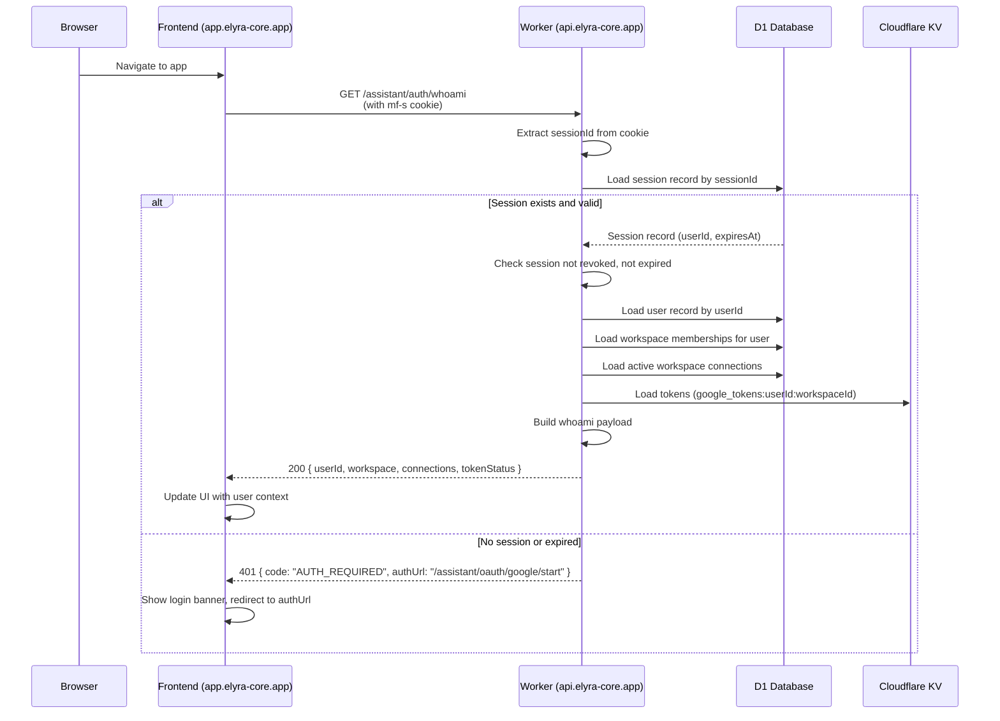
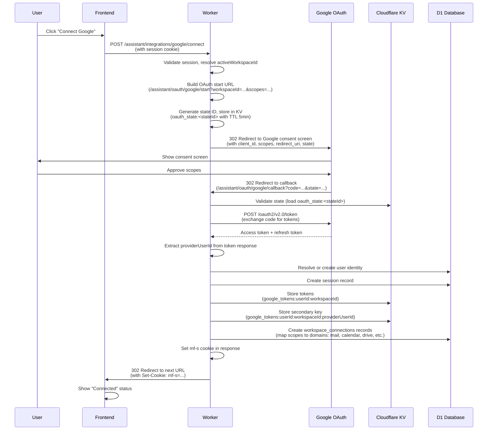
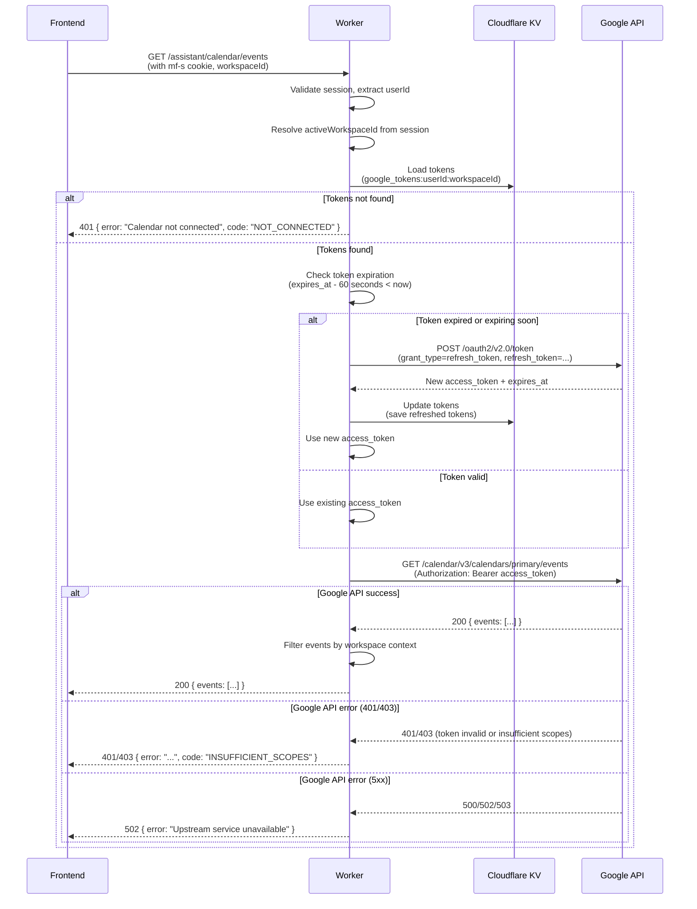

# Auth and OAuth Flows

## Overview

This document describes the authentication and OAuth integration flows that enable users to connect their Google and Microsoft accounts to workspaces. It covers session establishment, OAuth consent flows, token management, and failure modes.

## Glossary

**Session**: A server-side record (`sessions` table in D1) that associates a session ID with a user ID. The session ID is stored in an `mf-s` cookie (HttpOnly, Secure, SameSite=Lax) and is used to authenticate API requests. Sessions expire after a configured duration and can be revoked.

**WorkspaceId**: A unique identifier for a workspace. All OAuth tokens and connections are scoped to a specific workspace. A user can have multiple workspaces, each with separate OAuth connections.

**Connection**: A record in the `workspace_connections` table that tracks which OAuth provider (Google, Microsoft) is connected to a workspace, what scopes were granted, and which domains (mail, calendar, drive, etc.) are accessible.

**Tokens**: OAuth access and refresh tokens stored in Cloudflare KV. Tokens are stored with workspace-scoped keys: `google_tokens:<userId>:<workspaceId>` or `microsoft_tokens:<userId>:<workspaceId>`. Access tokens expire after 1 hour and are automatically refreshed using refresh tokens.

**KV key**: The storage key format in Cloudflare KV. For tokens: `{provider}_tokens:<userId>:<workspaceId>`. For OAuth state: `oauth_state:<stateId>`. Keys are workspace-scoped to enforce isolation.

## Flow A: User Opens App → Session Established → Whoami

This flow describes how a user's browser session is established and how the frontend determines authentication status.

**Key Points:**
- The `mf-s` cookie is HttpOnly and Secure, preventing JavaScript access
- Session validation checks expiration and revocation status
- The whoami endpoint returns workspace context and connection status
- If no session exists, the frontend receives a 401 with an authUrl for redirect

## Flow B: Connect Google → Start → Consent → Callback → Token Store → Workspace Connections

This flow describes the complete OAuth connection process for Google (Microsoft follows the same pattern with different endpoints).

**Key Points:**
- OAuth state is stored in KV with a 5-minute TTL to prevent CSRF attacks
- Tokens are stored with both primary and secondary keys for lookup flexibility
- Workspace connections are automatically created based on granted scopes
- The session cookie is set during the callback redirect
- The `next` parameter controls where the user is redirected after successful connection

**Reference:** See `docs/10_MVP_FEATURE_TO_CODE_MAP.md` for code locations (OAuth handlers at `worker/src/index.ts` lines ~12461-12621, token storage at `worker/src/google.ts`).

## Flow C: API Call → Requires Google Tokens → Refresh If Needed → Upstream Google API → Response

This flow describes how API operations that require Google tokens are handled, including automatic token refresh.

**Key Points:**
- Token refresh happens automatically with a 60-second buffer before expiration
- Refresh tokens are never exposed to the frontend
- If refresh fails, the user must re-authenticate
- Google API errors are mapped to appropriate HTTP status codes
- All API operations are workspace-scoped via the token lookup key

**Reference:** See `docs/10_MVP_FEATURE_TO_CODE_MAP.md` for token refresh implementation (`worker/src/google.ts` lines ~72-136).

## Failure Modes & What The User Sees

### 401 Unauthorized

**Scenario:** User is not authenticated or session expired.

**Causes:**
- No `mf-s` cookie present
- Session expired (past `expiresAt`)
- Session revoked (non-null `revokedAt`)

**User Experience:**
- Frontend receives: `401 { code: "AUTH_REQUIRED", authUrl: "/assistant/oauth/google/start?next=..." }`
- Frontend shows login banner and redirects to `authUrl`
- After successful OAuth, user is redirected back to original destination

**Code Location:** `worker/src/index.ts` - `buildAuthRequiredResponse()`, `getSessionFromRequest()`

### 403 Forbidden (Insufficient Scopes)

**Scenario:** OAuth connection exists but granted scopes are insufficient for the requested operation.

**Causes:**
- User connected Google but only granted `calendar.readonly` scope, and operation requires `calendar.write`
- Token has expired and refresh token is invalid or revoked

**User Experience:**
- Frontend receives: `403 { error: "Insufficient permissions", code: "INSUFFICIENT_SCOPES" }`
- Frontend shows error message: "This operation requires additional permissions. Please reconnect your Google account with the required scopes."
- Frontend provides link to reconnect: `/assistant/integrations/google/connect?scopes=calendar.write`

**Code Location:** Google API returns 403, worker maps to 403 response. See `worker/src/index.ts` lines ~8221-8277 for calendar connection checks.

### 409 Conflict (Not Connected)

**Scenario:** User attempts to use a feature that requires an OAuth connection, but no connection exists for the active workspace.

**Causes:**
- No tokens stored for workspace: `google_tokens:userId:workspaceId` returns null
- No `workspace_connections` record exists for the workspace

**User Experience:**
- Frontend receives: `401 { error: "Calendar not connected", code: "NOT_CONNECTED" }`
- Frontend shows: "Connect your Google account to use this feature"
- Frontend provides connect button: `/assistant/integrations/google/connect`

**Code Location:** `worker/src/index.ts` lines ~8221-8224, ~8274-8277

### 5xx Server Errors

**Scenario:** Upstream Google API is unavailable or worker encounters an internal error.

**Causes:**
- Google API returns 500/502/503
- Token refresh fails due to network error
- KV or D1 database unavailable
- Worker runtime error

**User Experience:**
- Frontend receives: `502 { error: "Upstream service unavailable" }` or `500 { error: "Internal server error" }`
- Frontend shows: "Service temporarily unavailable. Please try again later."
- Frontend may retry request after delay

**Code Location:** Error handling in API request wrappers. See `worker/src/index.ts` for error mapping.

### Token Refresh Failures

**Scenario:** Access token expired and refresh token is invalid or revoked.

**Causes:**
- User revoked access in Google account settings
- Refresh token expired (rare, but possible)
- OAuth app credentials changed

**User Experience:**
- Worker attempts refresh, receives error from Google
- Worker returns: `401 { error: "Token refresh failed. Please reconnect your account.", code: "TOKEN_REFRESH_FAILED" }`
- Frontend shows: "Your Google connection has expired. Please reconnect."
- Frontend provides reconnect link

**Code Location:** `worker/src/google.ts` lines ~72-136, `refreshGoogleAccessTokenIfNeeded()`

## Frontend to Worker Communication

### Origins and CORS

The frontend (hosted on `app.elyra-core.app` or `elyra-core.app`) makes API calls to the worker (hosted on `api.elyra-core.app`). CORS is configured to allow credentialed requests:

- **Allowed Origins:** `https://app.elyra-core.app`, `https://elyra-core.app`, plus any origins in `DASHBOARD_URL`/`DASHBOARD_URLS` env vars
- **Credentials:** `Access-Control-Allow-Credentials: true` is set for allowed origins
- **Methods:** `GET, POST, PUT, PATCH, DELETE, OPTIONS`
- **Headers:** Request headers are allowed via `Access-Control-Allow-Headers`

**Code Location:** `worker/src/index.ts` - `buildCorsHeaders()`, `allowCorsResponse()`

### Cookie Transmission

The `mf-s` session cookie is:
- Set by the worker with `Domain=.elyra-core.app` (allows subdomain sharing)
- HttpOnly (not accessible to JavaScript)
- Secure (only sent over HTTPS)
- SameSite=Lax (sent on same-site requests and top-level navigations)
- Path=/ (sent with all requests to the domain)

The frontend uses `fetch(..., { credentials: "include" })` to ensure cookies are sent with API requests.

**Code Location:** `worker/src/index.ts` - `buildSessionSetCookie()`, `getCookieAttributes()`

## Cross-References

- **Feature to Code Map:** `docs/10_MVP_FEATURE_TO_CODE_MAP.md` - Maps OAuth flows to specific code locations
- **OAuth Integrations Overview:** `docs/02_OAUTH_INTEGRATIONS_OVERVIEW.md` - Detailed OAuth scope mappings and provider configurations
- **Workspace Isolation:** `docs/12_WORKSPACE_ISOLATION_GUARANTEES.md` - How workspace scoping is enforced

## Open Questions

- Should we support incremental scope requests (request additional scopes after initial OAuth without full re-authentication)?
- How should token expiration be handled if refresh fails (should we attempt re-auth automatically or require user action)?
- Should provider user IDs be stored separately for multi-account scenarios (same user, multiple Google accounts)?
- What is the recommended approach for handling OAuth consent screen changes (scope updates) without breaking existing connections?
- How should workspace deletion cascade to OAuth tokens and connections (should tokens be deleted immediately or after a grace period)?
- Should Microsoft integration support tenant-specific configurations beyond `MICROSOFT_TENANT_ID`?
- What is the recommended session expiration duration for production (currently configurable via `SESSION_MAX_AGE_SECONDS`)?
- Should we implement session refresh (extend expiration on activity) or fixed expiration windows?

