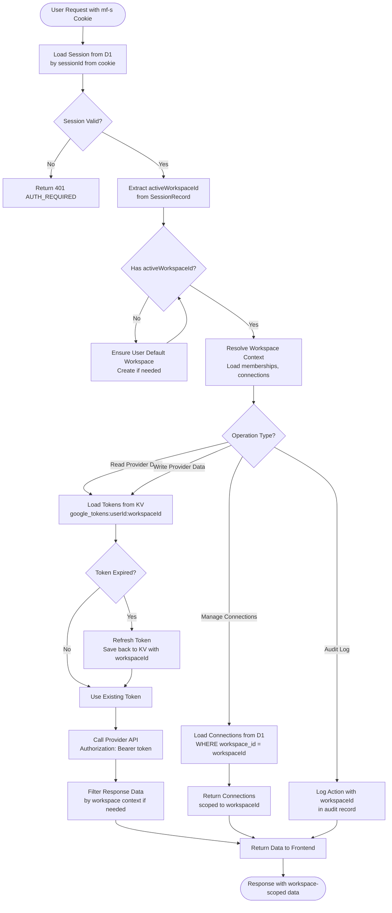

# Workspace Isolation Guarantees

## Overview

This document describes the architectural invariants that ensure workspace isolation in the MIRA platform. Workspace isolation means that data, tokens, and operations for one workspace cannot be accessed or modified by users or code operating in a different workspace context.

## Invariants

### 1. Tokens are Stored Per {userId, workspaceId}

**Invariant:** All OAuth tokens are stored with workspace-scoped keys in Cloudflare KV. The key format is: `{provider}_tokens:<userId>:<workspaceId>`.

**Enforcement:**
- Token storage functions require both `userId` and `workspaceId` parameters
- Token lookup functions require `workspaceId` to construct the key
- There are no global tokens, no user-level tokens without workspace context
- Secondary keys may exist for provider user ID lookup, but they contain the same workspace-scoped data

**Code Evidence:**
- `worker/src/google.ts` - `workspaceTokenKey(userKey, workspaceId)` constructs keys with workspace ID
- `worker/src/index.ts` - `saveGoogleTokens()` and `saveMicrosoftTokens()` require workspaceId parameter
- `worker/src/index.ts` - `loadGoogleTokens()` and `loadMicrosoftTokens()` require workspaceId parameter

**Violation Prevention:**
- Token storage functions will not save tokens without a workspaceId (or will use a fallback that still includes workspace context)
- Token lookup without workspaceId will fail or return null
- Cross-workspace token access is architecturally impossible because the key includes workspaceId

### 2. Connections are Workspace-Scoped

**Invariant:** All `workspace_connections` records in D1 are associated with a specific `workspace_id`. Connections cannot be shared across workspaces.

**Enforcement:**
- `workspace_connections` table has a `workspace_id` column (NOT NULL, foreign key to `workspaces`)
- All queries that read or write connections filter by `workspace_id`
- Connection creation functions require `workspaceId` parameter
- Connection lookup functions require `workspaceId` parameter

**Code Evidence:**
- `worker/src/index.ts` - `ensureGoogleWorkspaceConnections()` requires `workspaceId` parameter
- `worker/src/index.ts` - `listWorkspaceConnectionsForWorkspace()` filters by `workspace_id`
- Database schema: `workspace_connections.workspace_id` is a required foreign key

**Violation Prevention:**
- Database foreign key constraints prevent orphaned connections
- Application code always filters by workspace_id in queries
- No API endpoint allows reading connections without workspace context

### 3. No Cross-Workspace Reads/Writes

**Invariant:** API operations that access external provider data (Google Calendar, Gmail, Drive, etc.) can only access data using tokens scoped to the active workspace. Operations cannot read or write data from other workspaces.

**Enforcement:**
- All API endpoints that require provider tokens first resolve the active workspace from the session
- Token lookup uses the active workspace ID: `google_tokens:userId:activeWorkspaceId`
- Provider API calls use tokens from the active workspace only
- No API endpoint accepts a `workspaceId` parameter that differs from the session's active workspace (unless the user has explicit cross-workspace permissions, which is not in MVP scope)

**Code Evidence:**
- `worker/src/index.ts` - `resolveSessionActiveWorkspaceId()` determines workspace from session
- `worker/src/index.ts` - Calendar, Tasks, Drive, Email endpoints all use `resolveSessionActiveWorkspaceId()`
- `worker/src/index.ts` - `resolveDriveContext()`, `resolveCalendarContext()` require workspace context

**Violation Prevention:**
- Workspace ID is resolved from session, not from user input
- Token lookup always uses session-derived workspace ID
- Provider API calls cannot use tokens from a different workspace because keys are workspace-scoped

### 4. Workspace Context Propagation

**Invariant:** The `workspaceId` enters the system via the session's `activeWorkspaceId` and is propagated to all operations that require workspace context.

**Enforcement:**
- Session records include `activeWorkspaceId` field
- Session is loaded on every authenticated request
- Workspace ID flows from session → token lookup → provider API calls
- Workspace ID is included in audit logs and connection records

**Code Evidence:**
- `worker/src/index.ts` - `SessionRecord` type includes `activeWorkspaceId`
- `worker/src/index.ts` - `getSessionFromRequest()` loads session with workspace context
- `worker/src/index.ts` - All provider API operations call `resolveSessionActiveWorkspaceId()`

## Workspace ID Propagation Flow

This flowchart shows where `workspaceId` enters the system and how it is propagated through operations.

**Key Points:**
- Workspace ID originates from the session record, not user input
- All token lookups use the workspace ID from the session
- All database queries filter by workspace ID
- Provider API calls use workspace-scoped tokens
- Audit logs include workspace ID for traceability

## Audit Points

The following operations should be logged for audit purposes. Each audit record should include: `userId`, `workspaceId`, `action`, `timestamp`, and relevant context (non-sensitive data only).

### Connection Operations

**Connect:**
- Event: User initiates OAuth connection for a workspace
- Log: `{ action: "connect", provider: "google", workspaceId, userId, scopes: [...] }`
- Location: `worker/src/index.ts` - `handleAssistantOAuthCallback()` after token storage

**Disconnect:**
- Event: User disconnects OAuth integration
- Log: `{ action: "disconnect", provider: "google", workspaceId, userId }`
- Location: `worker/src/index.ts` - DELETE `/assistant/integrations/:provider` endpoint

### Read Operations

**Calendar Events List:**
- Event: User requests calendar events
- Log: `{ action: "read", domain: "calendar", workspaceId, userId, eventCount: N }`
- Location: `worker/src/index.ts` - `GET /assistant/calendar/events`

**Email Inbox Read:**
- Event: User requests inbox emails
- Log: `{ action: "read", domain: "mail", workspaceId, userId, emailCount: N }`
- Location: `worker/src/index.ts` - `POST /assistant/email/inbox` or similar

**Drive Files List:**
- Event: User requests Drive files
- Log: `{ action: "read", domain: "drive", workspaceId, userId, fileCount: N }`
- Location: `worker/src/index.ts` - `GET /assistant/drive/files`

**Tasks List:**
- Event: User requests tasks
- Log: `{ action: "read", domain: "tasks", workspaceId, userId, taskCount: N }`
- Location: `worker/src/index.ts` - `GET /assistant/tasks`

### Write Operations

**Calendar Event Create:**
- Event: User creates calendar event
- Log: `{ action: "write", domain: "calendar", workspaceId, userId, operation: "create" }`
- Location: `worker/src/index.ts` - `POST /assistant/calendar/events`

**Task Create:**
- Event: User creates task
- Log: `{ action: "write", domain: "tasks", workspaceId, userId, operation: "create" }`
- Location: `worker/src/index.ts` - `POST /assistant/tasks`

**Drive File Upload:**
- Event: User uploads file to Drive
- Log: `{ action: "write", domain: "drive", workspaceId, userId, operation: "upload", fileId: "..." }`
- Location: `worker/src/index.ts` - `POST /assistant/drive/files`

**Email Send:**
- Event: User sends email
- Log: `{ action: "write", domain: "mail", workspaceId, userId, operation: "send", recipient: "..." }`
- Location: `worker/src/index.ts` - Email send endpoints

### Delete Operations

**Calendar Event Delete:**
- Event: User deletes calendar event (with confirmation)
- Log: `{ action: "delete", domain: "calendar", workspaceId, userId, operation: "delete", eventId: "..." }`
- Location: `worker/src/index.ts` - `POST /assistant/calendar/delete` (requires `confirm: true`)

**Slides Presentation Delete:**
- Event: User deletes presentation (with confirmation)
- Log: `{ action: "delete", domain: "slides", workspaceId, userId, operation: "delete", presentationId: "..." }`
- Location: `worker/src/index.ts` - `POST /assistant/slides/delete` (requires `confirm: true`)

**Task Delete:**
- Event: User deletes task
- Log: `{ action: "delete", domain: "tasks", workspaceId, userId, operation: "delete", taskId: "..." }`
- Location: `worker/src/index.ts` - Task delete endpoints

### Confirmation Operations

**Delete Confirmation:**
- Event: User confirms a delete operation
- Log: `{ action: "confirm", domain: "...", workspaceId, userId, operation: "delete", resourceId: "..." }`
- Location: Delete endpoints that require `confirm: true` parameter

**Note:** Audit logging is currently planned but not fully implemented. See `docs/08_SECURITY_AND_GOVERNANCE.md` for audit logging specification.

## Isolation Verification

### Token Isolation Verification

**Test:** Attempt to access tokens from a different workspace.

**Steps:**
1. User A has workspace W1 with Google tokens
2. User A switches to workspace W2 (no tokens)
3. Attempt to list calendar events for W2
4. System should return 401 "Calendar not connected" (not tokens from W1)

**Expected Result:** Tokens from W1 (`google_tokens:userA:W1`) are not accessible when operating in W2 context. Token lookup for W2 (`google_tokens:userA:W2`) returns null.

### Connection Isolation Verification

**Test:** Attempt to read connections from a different workspace.

**Steps:**
1. Workspace W1 has Google connection (calendar, mail)
2. Workspace W2 has no connections
3. User switches to W2
4. Attempt to list integrations for W2
5. System should return empty connections list (not W1's connections)

**Expected Result:** `listWorkspaceConnectionsForWorkspace(env, W2)` returns empty array. Connections from W1 are not returned because query filters by `workspace_id = W2`.

### Data Isolation Verification

**Test:** Attempt to access provider data using tokens from a different workspace.

**Steps:**
1. User has two workspaces: W1 (connected to Google account G1) and W2 (connected to Google account G2)
2. User is in W1 context (activeWorkspaceId = W1)
3. Attempt to list calendar events
4. System should use tokens from W1 (`google_tokens:userId:W1`) and return events from G1

**Expected Result:** Calendar events from G1 are returned. Events from G2 are not accessible because tokens from W2 are not used.

## Cross-References

- **Feature to Code Map:** `docs/10_MVP_FEATURE_TO_CODE_MAP.md` - Maps workspace-scoped operations to code locations
- **Auth and OAuth Flows:** `docs/11_AUTH_AND_OAUTH_FLOWS.md` - Describes how workspace context is established in OAuth flows
- **Security and Governance:** `docs/08_SECURITY_AND_GOVERNANCE.md` - Security considerations and audit logging requirements

## Open Questions

- Should we implement cross-workspace permissions (allow user in W1 to access data from W2 with explicit permission)?
- How should workspace deletion handle orphaned tokens (delete immediately or after grace period)?
- Should audit logs be stored in D1, external logging service, or both?
- What is the recommended retention period for audit logs?
- Should we implement workspace-level access control lists (ACLs) for fine-grained permissions?
- How should workspace isolation be tested in automated test suites?
- Should we implement workspace-level rate limiting to prevent abuse?
- What is the recommended approach for workspace data export (GDPR compliance)?

