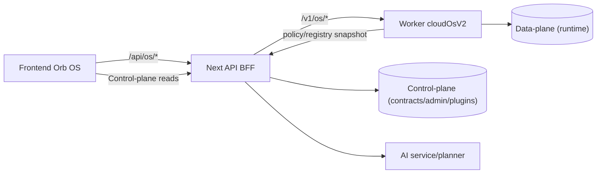

# Elyra OS Milestones 1–8 (Implementation Package)

## Milestone 1 — Single Runtime Backbone (SSOT)

### 1) Target Architecture Diagram

### 2) Final `/v1/os` API Contracts (authoritative backbone)

- `POST /v1/os/runs`
  - input: `intent_text`, optional `nodes`/`plan_json`, optional `goal_id`, `parent_run_id`
  - output: `run.id`, `status`, `plan_version`
- `GET /v1/os/runs?limit=&status=`
  - output: workspace-scoped runs
- `GET /v1/os/runs/:run_id`
  - output: run detail + `run_steps` + `tool_calls` + `artifacts` + graph nodes
- `POST /v1/os/runs/:run_id/cancel`
- `POST /v1/os/runs/:run_id/resume`
- `POST /v1/os/worker/tick`
- `GET /v1/os/approvals`
- `POST /v1/os/approvals/:approval_id/approve`
- `POST /v1/os/approvals/:approval_id/reject`
- `GET /v1/os/tools`
- `POST /v1/os/tools`

### 3) Migration Plan (Frontend-execution -> Worker)

1. Dual-write transition (current): Frontend writes run_events + artifacts while Worker remains available.
2. Route shift: quick actions call `POST /v1/os/runs` with single-node plan.
3. Async completion: FE polls `GET /v1/os/runs/:id` or SSE from Worker, not local tool runtime.
4. Cutover: disable local `/api/os/tools/execute` adapter path after parity tests (`410` in SSOT mode).
5. Rollback: feature flag to revert to local runtime for critical incidents.

### 4) Browser-independent run proof

- Added worker backbone client + test that creates/ticks/reads run to terminal without UI session:
  - `lib/orb-os/runtime/backbone.ts`
  - `tests/runtime-backbone.test.ts`
- Added browser-close E2E proof:
  - `tests/os-run-browser-close.spec.ts`
  - smoke UI: `app/os/smoke/backbone/page.tsx`

### 5) Proxy signing hardening

- Frontend `/api/os/*` -> Worker proxy now signs each request (HMAC):
  - headers: `x-elyra-proxy-ts`, `x-elyra-proxy-nonce`, `x-elyra-proxy-signature`
- Worker rejects unsigned/invalid proxy signatures when enabled via env:
  - `ASSISTANT_OS_REQUIRE_PROXY_SIGNATURE=1`
  - `ASSISTANT_OS_PROXY_SECRET=<shared-secret>`

---

## Milestone 2 — DB-backed Contracts

### 1) SQL Schema

- Added migration `0004_orb_os_contracts_events.sql` with:
  - `workspace_capabilities`
  - `app_manifests` (versioned/latest)
  - `installed_apps`
  - `tool_registry_entries` (versioned)
  - `workspace_policies`
  - `run_events`
  - `os_admin_audit_log`

### 2) RLS Strategy

- Workspace-scoped tables use `public.has_workspace_access(workspace_id)` in `USING` and `WITH CHECK`.
- `app_manifests` globally readable; write policy currently open for service-role controlled writes.

### 3) Versioning Strategy

- App manifests use `(app_id, manifest_version)` and `is_latest` unique partial index.
- Tool registry entries keep `version` + per-workspace override capability.
- Workspace capabilities include `contract_version` and `policy_version`.

### 4) Bootstrap refactor

- Added DB loader with fallback and optional seed:
  - `lib/orb-os/contracts/store.ts`
- Refactored APIs to use DB source:
  - `/api/os/bootstrap`
  - `/api/os/dashboard`
  - `/api/os/profile`
  - `/api/os/integrations/diagnose`
  - `/api/os/workspace-admin`

### 5) Admin writes + audit

- `PATCH /api/os/workspace-admin/capabilities` writes to DB + appends audit.
- `PATCH /api/os/workspace-admin/apps` writes to DB + appends audit.
- Workspace Admin audit tab now reads from `os_admin_audit_log`.

---

## Milestone 3 — run_events + Read Models

### 1) Schema

- `run_events` append-only table in migration `0004_orb_os_contracts_events.sql`.
- Event types implemented exactly per contract list.

### 2) Read model builder

- `lib/orb-os/events/store.ts` provides append/list.
- `/api/os/runs/[runId]/events` builds deterministic read model (`status`, timeline).

### 3) Migration/Backfill plan

1. Add table and start appending for new runs.
2. Optional backfill script from `orchestration_runs`, `tool_calls`, `os_tool_artifacts`.
3. Enable UI read path from events.

### 4) Timeline events emitted

- Quick action route now appends:
  - `RUN_CREATED`, `PLAN_WRITTEN`, `TOOL_REQUESTED`, `TOOL_STARTED`
  - `APPROVAL_REQUIRED` / `AUTH_REQUIRED`
  - `TOOL_COMPLETED`, `ARTIFACT_CREATED`, `RUN_SUCCEEDED`, `RUN_FAILED`

---

## Milestone 4 — Capability-based Security

### Server enforcement order

Implemented in `lib/orb-os/security/enforcement.ts`:
1. membership + role
2. capability enabled
3. tool enabled + app installed/enabled
4. integration auth + scopes
5. policy risk decision
6. approval check
7. execute
8. audit/usage hooks (persisted through existing runtime paths)

### Tests

- `tests/security-enforcement.test.ts` validates bypass resistance and gating outcomes.

---

## Milestone 5 — Token & Secrets Hardening

### Key management

- Added per-workspace key derivation from master key:
  - `lib/orb-os/integrations/keys.ts`
- TokenStore now encrypts/decrypts with workspace-derived key.

### Revocation/failure mapping

- Added deterministic OAuth failure mapper:
  - `lib/orb-os/integrations/failures.ts`
- `invalid_grant` maps to reconnect/needs_auth.

### Tests

- `tests/security-hardening.test.ts` covers key isolation + failure mapping.

---

## Milestone 6 — Observability & Incidents

### Operability design added

- `lib/orb-os/observability/metrics.ts`
  - metrics: `run_success_rate`, `queue_lag`, `p95_tool_latency`, `approval_time`, `auth_failure_rate`
  - in-memory emitter for development + incident threshold logic

### Incident trigger conditions

- Trigger when any critical threshold exceeded:
  - success rate < 0.8
  - queue lag > 120s
  - auth failure rate > 0.25
  - p95 tool latency > 20s

---

## Milestone 7 — Eval & Regression Harness

### Dataset format

- `evals/golden-prompts.json`
  - fields: `id`, `prompt`, `expected_tool`, `severity`

### Runner

- `scripts/eval-harness.ts`
- deterministic rule evaluator in `lib/orb-os/evals/plannerRules.ts`

### Tolerance rules

- configurable via env:
  - `EVAL_MIN_PASS_RATE` (default `0.90`)
  - `EVAL_MAX_HIGH_FAIL` (default `0`)

### CI integration

- npm script: `test:eval-harness`

---

## Milestone 8 — Marketplace-ready Plugin Runtime

### Plugin schema + validation

- `lib/orb-os/plugins/schema.ts`
  - permission declarations
  - risk/limits/runtime/install/rollback metadata
  - validation guardrails (e.g. sandbox runtime cannot use `builder.applyPatch`)

### Execution sandbox model (contract)

- runtimes:
  - `worker_internal`
  - `worker_webhook`
  - `sandbox_http`

### Threat model (condensed)

1. Privilege escalation via manifest permissions -> blocked by validator + policy gate.
2. SSRF / lateral movement -> sandbox runtime restrictions + host allowlists.
3. Cost abuse -> per-plugin rate + daily budget caps.
4. Supply-chain rollback -> versioned manifest + rollback metadata + install audit trail.
