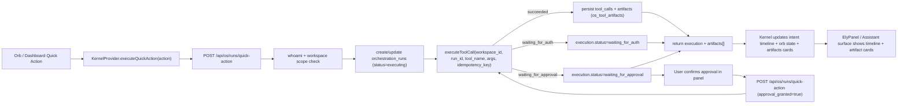

# Elyra OS Quick Action Run Flow

## End-to-end flow

## Integration points

1. UI entrypoints (quick actions)
   - `components/os/shell/OrbArea.tsx`
   - `components/os/shell/DesktopSurface.tsx`
2. Kernel orchestration (client state + timeline)
   - `components/os/kernel/KernelProvider.tsx`
   - New method in context: `executeQuickAction(action)`
3. Client API call
   - `components/os/kernel/aiClient.ts`
   - New method: `executeQuickAction(...)`
4. Backend run endpoint
   - `app/api/os/runs/quick-action/route.ts`
   - Validates workspace scope, ensures run row, calls tool execution service, maps waiting states, returns artifacts.
5. Tool execution runtime
   - `lib/orb-os/tools/execution.ts`
   - Supports approval gate bypass with `approval_granted`.
6. Artifact rendering
   - `components/os/shell/cards/ArtifactResultCard.tsx`
   - `components/os/shell/ElyPanel.tsx`
   - `components/os/shell/DesktopSurface.tsx`
